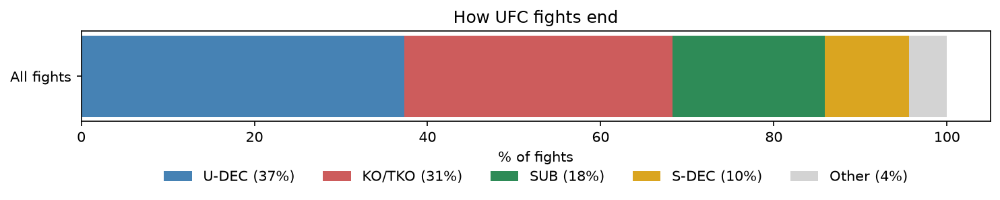
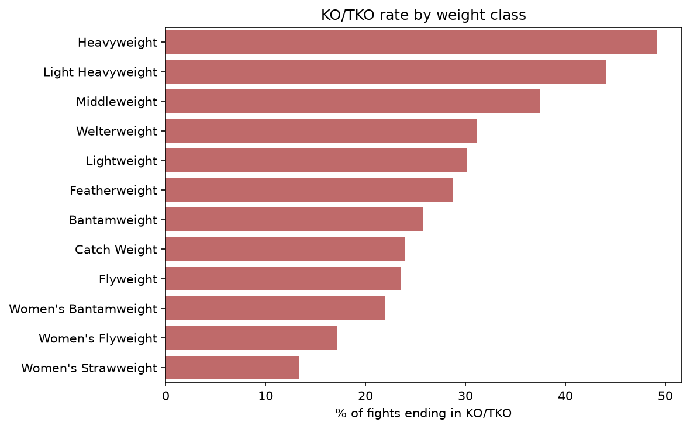

# Tap or Knockout? What Weight Class Says About How UFC Fights End

An analysis of 7,177 UFC fights (March 2010 to March 2026) looking at how fights end, which submissions dominate, and how weight class shapes the finish.

MMA is one of my hobbies, so I wanted to explore real UFC data. The project started with a simple question: how do fights end?

**[Read the full analysis: `ufc-finishes-analysis.ipynb`](ufc-finishes-analysis.ipynb)**



## Key findings

- **Submissions are the least common main finish**, at about 18% of fights.
- **One technique dominates.** The rear-naked choke accounts for over 40% of submissions, and chokes overall make up roughly 80%.
- **Weight class shapes the finish.** About 1 in 5 lightweight fights ends in a submission (20%), compared with 12% at heavyweight.
- **Knockouts show a much bigger gap.** KO/TKO ends 49.2% of heavyweight fights but only 23.5% of flyweight fights (31% overall).
- **Lighter fighters attempt more submissions.** Flyweights average about 0.7 attempts, heavyweights about 0.3 (0.51 overall).
- **The pattern is stable over time.** Since 2011, between roughly 15% and 20% of fights each year have ended by submission, with no clear trend.



## Questions explored

1. How do UFC fights end?
2. Which submission is the most common?
3. Who finishes fights by submission?
4. Are heavyweights more likely to end fights by knockout?
5. Do lighter fighters actually attempt more submissions?
6. Is the pattern stable over time?

## Data

[Ultimate UFC Dataset](https://www.kaggle.com/datasets/mdabbert/ultimate-ufc-dataset) by Matt Dabbert on Kaggle. It combines fight and fighter statistics from ufcstats.com with betting odds and rankings. The notebook downloads it automatically on the first run.

## How to run it

```bash
git clone https://github.com/YOUR_USERNAME/ufc-finishes-analysis.git
cd ufc-finishes-analysis
pip install -r requirements.txt
jupyter notebook ufc-finishes-analysis.ipynb
```

The dataset is downloaded to a `data/` folder with `kagglehub` (you may need a free Kaggle account).

## Project structure

```
ufc-finishes-analysis/
├── ufc-finishes-analysis.ipynb   # the analysis and written story
├── helpers.py                    # reusable loading and plotting functions
├── images/                       # saved charts
├── requirements.txt
└── README.md
```

## Limitations

- The data only records successful finishes, so I can't measure how often submission attempts succeed.
- Weight-class differences describe patterns, not causes. Explanations such as heavier fighters having more knockout power are hypotheses this data can't test.
- The women's divisions are the lightest and have fewer fights, so weight and gender overlap in the charts.
- Catch weight was excluded because of its small sample and mixed bouts. 2010 and 2026 are partial years.
- I did not test whether weight-class patterns changed over time, only the overall submission rate.

## Tools

Python, pandas, NumPy, seaborn, matplotlib, plotly, Jupyter.

## Next steps

Add fighter nationality (from a second source) to study where UFC fighters come from and how the roster has changed.